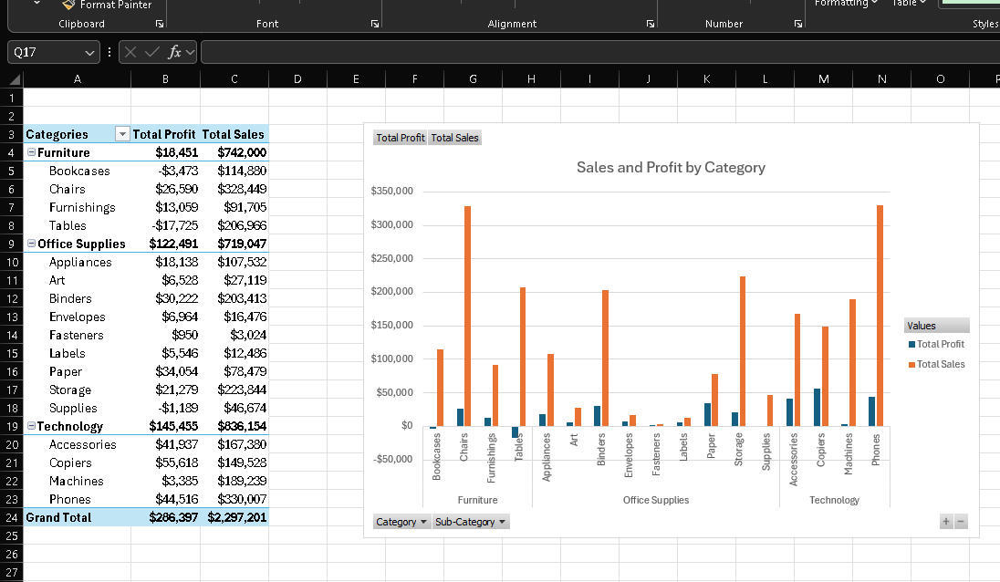
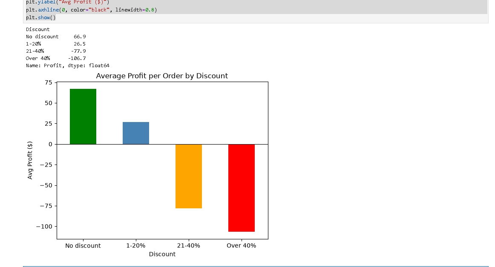
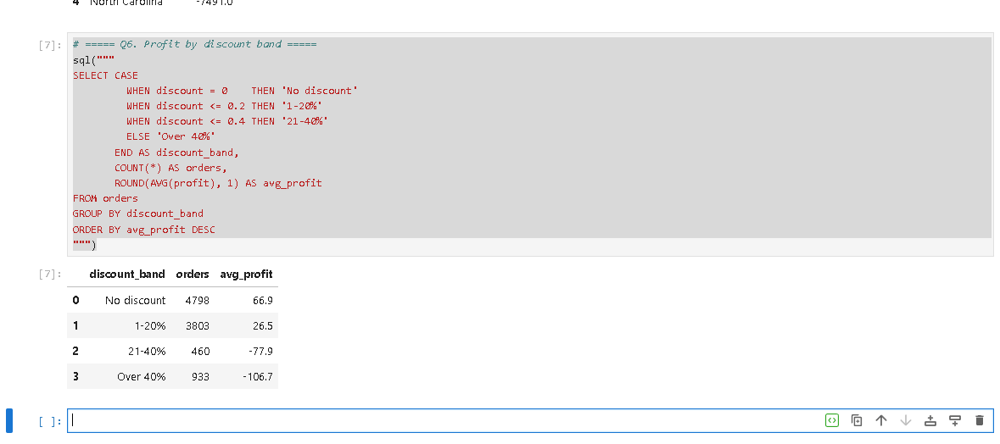
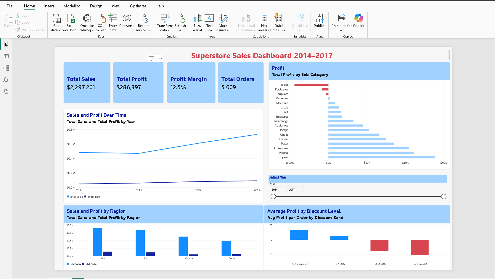

# Superstore Sales Analysis (2014–2017)

An end-to-end data analytics project on the **Sample Superstore** dataset (9,994 orders, 21 columns), using Excel, Python, SQL and Power BI to find out where the business makes and loses money.

## Business question
Sales are growing, but is the business profitable everywhere? Which products, regions and practices are hurting profit?

## Tools used
| Part | Tool | What I did |
|---|---|---|
| 1 | Excel | Inspected and cleaned the data, added helper columns, calculated KPIs, built PivotTables and PivotCharts |
| 2 | Python (Jupyter, pandas, matplotlib) | Explored trends, identified loss-making products, tested the discount–profit relationship |
| 3 | SQL (SQLite in Jupyter) | Answered 9 business questions using filtering, grouping, joins, CASE, window functions (LAG, RANK) |
| 4 | Power BI | Built an interactive dashboard with KPI cards, 4 charts, conditional formatting and a Year filter |
| 5 | Tableau | In progress |

## Key numbers
| KPI | Value |
|---|---|
| Total Sales | $2,297,201 |
| Total Profit | $286,397 |
| Profit Margin | 12.5% |
| Orders | 5,009 |
| Customers | 793 |

## Key findings
1. **Sales grew 51% from 2014 to 2017** ($484K → $733K). Sales dipped 2.8% in 2015, then grew 29.5% (2016) and 20.4% (2017). Profit rose every year.
2. **Furniture is barely profitable:** $742K in sales but only $18K profit (2.5% margin), compared with about 17% for Technology and Office Supplies.
3. **Three sub-categories lose money:** Tables (−$17,725), Bookcases (−$3,473) and Supplies (−$1,189).
4. **Discounts above 20% destroy profit.** Average profit per order:
   - No discount: +$66.9
   - 1–20%: +$26.5
   - 21–40%: −$77.9
   - Over 40%: −$106.7
5. **Central region:** strong sales ($501K) but the lowest margin (7.9%). It also gives the highest average discount (24%).
6. **Biggest losses by state:** Texas (−$25.7K), Ohio (−$17.0K), Pennsylvania (−$15.6K).

## Recommendations
- Cap discounts at 20%.
- Review pricing on Tables and Bookcases.
- Investigate costs for Supplies, which loses money even with low discounts (about 8% on average).
- Review discount practices in the Central region and in Texas, Ohio and Pennsylvania.

## Files
| File | Description |
|---|---|
| `Sample - Superstore.csv` | Raw dataset |
| `Superstore_Sales_Analysis.xlsx` | Excel cleaning, KPIs, PivotTables, charts and findings |
| `superstore_analysis.ipynb` | Python exploratory analysis |
| `superstore_sql.ipynb` | SQL queries answering business questions |
| `Superstore_Dashboard_Final.pbix` | Power BI dashboard (open with Power BI Desktop) |
| `Superstore_Dashboard.pdf` | PDF export of the Power BI dashboard |

## Screenshots

### 1. Excel: PivotTables and charts

### 2. Python (Jupyter): average profit by discount level

### 3. SQL: loss-making sub-categories and discount bands

### 4. Power BI: interactive dashboard

## Author
Wamba Jose
